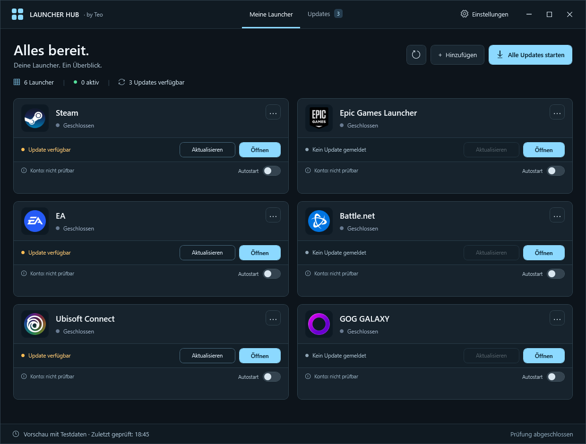

# Launcher Hub · by Teo

Ein kleiner Windows-Launcher mit großen Kacheln für deine installierten Game-Launcher.

## Starten

1. Lade `LauncherHub-Portabel.zip` herunter und entpacke es vollständig.
2. Starte **`LauncherHub.exe`** per Doppelklick. Dabei erscheint kein schwarzes CMD-/PowerShell-Fenster.

Bereits vorhandene Desktop-Verknüpfungen bitte auf `LauncherHub.exe` umstellen. `LauncherHub.cmd` bleibt als alter Ersatzstart verfügbar; Windows öffnet dabei kurz eine Konsole.

Windows 10 oder 11 und Windows PowerShell 5.1 werden benötigt. Alle Dateien müssen im selben Ordner bleiben. Das Programm selbst enthält keine Spiele oder Launcher.

## Funktionen

- Das neue **Graphit-&-Eisblau-Design** zeigt breite Kacheln in zwei Spalten. Bei schmalen Fenstern wechseln sie untereinander. Laufstatus, Updates und Kontohinweise stehen in getrennten Bereichen.
- **Meine Launcher** zeigt alle Einträge, **Updates** die erkannten Updates und Ergebnisse des letzten Durchlaufs.
- **Auto-Erkennung** im Einstellungsmenü (Zahnrad) sucht bekannte Launcher im Startmenü, auf dem Desktop und in Windows-Installationseinträgen. Ein leerer Hub bietet sie auch direkt an.
- **Hinzufügen** nimmt eigene `.exe`-, `.lnk`- oder `.url`-Dateien auf.
- Das **⋯-Menü** auf einer Kachel entfernt den Eintrag nur aus dem Hub. Das Programm bleibt installiert.
- Kacheln lassen sich mit der Maus auf andere Kacheln ziehen. Die Reihenfolge wird gespeichert.
- Größe und Position des Fensters bleiben nach dem Schließen erhalten.
- **Autostart** auf jeder Kachel legt eine Verknüpfung im persönlichen Windows-Autostart-Ordner an oder entfernt sie. Programmeigene Autostart-Einstellungen bleiben davon unberührt; sind sie ebenfalls aktiv, kann der Launcher doppelt starten.
- Der grüne Punkt zeigt einen erkannten laufenden Prozess an.
- **Aktualisieren** installiert ein erkanntes Update direkt auf der jeweiligen Kachel.
- **Alle Updates starten** aktualisiert alle unterstützten Programme mit erkanntem Update **im Hub**, nacheinander. Andere Programme auf dem PC werden nicht aktualisiert. Es gibt keine unbeaufsichtigte Installation beim Windows- oder Hub-Start.
- Währenddessen zeigen die Kacheln „Wartet“ oder „Wird aktualisiert“ und anschließend das Ergebnis. Nach dem Durchlauf prüft der Hub die Versionen erneut. Fehler bei einem Programm verhindern die übrigen Updates nicht.
- Für Programme ohne direkte Update-Unterstützung öffnet **Im Launcher prüfen** das Programm. Auch selbst hinzugefügte Programme ohne bekannte Paketzuordnung werden so behandelt.
- **Konto: nicht prüfbar** steht getrennt von „Läuft“/„Geschlossen“. Der Hub kann eine Anmeldung derzeit nicht verlässlich feststellen. Ein grüner Laufpunkt bedeutet keine bestätigte Anmeldung; gespeicherte Accounts sind ebenfalls kein Nachweis. Es werden keine Login-Tokens, Passwörter oder Cookies gelesen.

## Updates: Voraussetzungen und Grenzen

Für die automatische Updateprüfung und direkte Installation wird **WinGet** benötigt (Microsoft App-Installer). Der Hub ordnet bekannte Launcher anhand einer exakten Paket-ID zu und verwendet die WinGet-Quelle. Fehlt eine eindeutige Update-Zeile mit Zielversion, wird kein Update angeboten. Bereits aktuelle Programmdateien werden nach Möglichkeit erkannt; WinGet entscheidet beim Installieren erneut, ob das Update anwendbar ist.

Ein Klick auf „Aktualisieren“ bzw. „Alle Updates starten“ startet die Installation mit bestätigten Quell- und Paketbedingungen. Windows kann um Administratorberechtigung bitten. Laufende Launcher können die Installation blockieren; dann den betroffenen Launcher schließen und erneut versuchen. Der Hub beendet keine Programme zwangsweise und fordert keinen automatischen Windows-Neustart an. Während einer Update-Warteschlange bleibt der Hub geöffnet, damit Ergebnisse erfasst werden können.

Fehler und die WinGet-Ausgabe des letzten Update-Durchlaufs stehen lokal unter `%APPDATA%\LauncherHub\last-update-log.json` und lassen sich über das Einstellungsmenü öffnen. Netzwerkfehler oder ein fehlendes WinGet werden als „Prüfung nicht verfügbar“ angezeigt und niemals als „aktuell“ gewertet. Spielebibliotheken und Spiel-Updates sind noch nicht enthalten.

## Entwicklung

`powershell.exe -NoProfile -ExecutionPolicy Bypass -File .\Build.ps1` baut den konsolenlosen Windows-Start (`LauncherHub.Start.cs`, .NET Framework) und das portable Paket. `LauncherHub.exe` enthält keinen Installer; alle Skripte bleiben im selben Ordner. Das selbst erstellte Startprogramm ist nicht digital signiert.

`powershell.exe -NoProfile -ExecutionPolicy Bypass -STA -File .\tests\Test-Updates.ps1` prüft die Update-Logik und Warteschlange mit simulierten Ergebnissen, ohne Programme zu installieren.

`LauncherHub.xaml` enthält die Oberfläche und gemeinsamen Stile, `LauncherHub.Card.xaml` die Kacheln. Beide Dateien gehören zum portablen Paket. Native Programmsymbole stammen von den lokalen Launcher-Dateien; fehlt ein Symbol, erscheint der Anfangsbuchstabe als Ersatz.

Jeder Windows-Nutzer hat eine eigene Auswahl unter `%APPDATA%\LauncherHub\config.json`. Diese Konfigurationsdatei gehört **nicht** zum Download; jeder PC erkennt seine eigenen Launcher.
